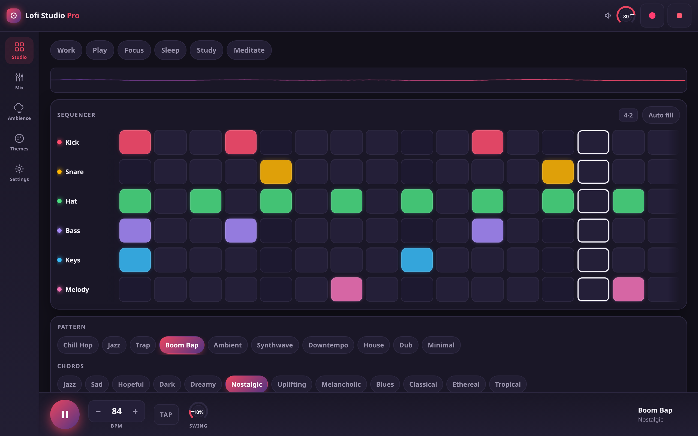
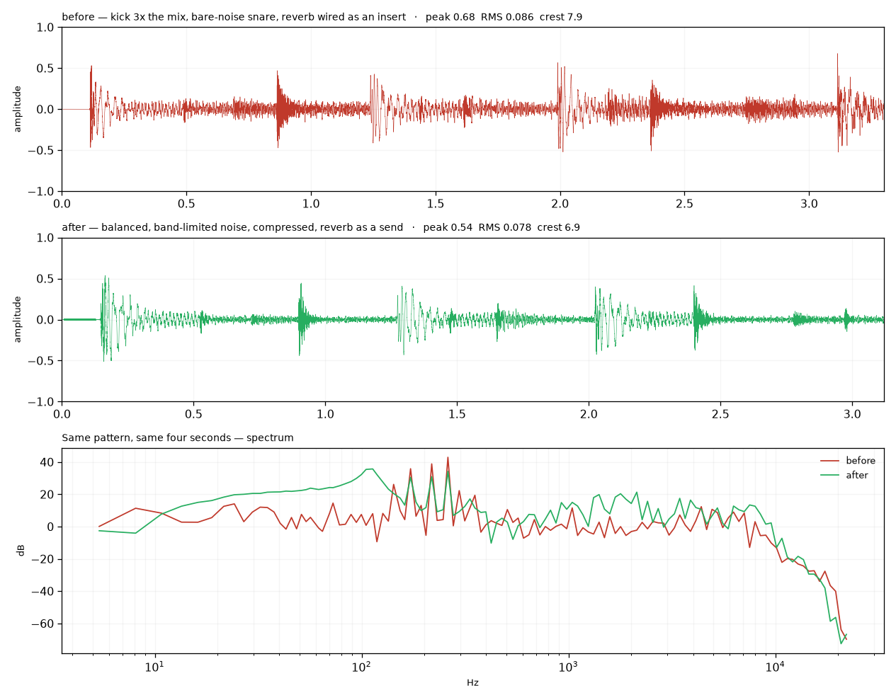
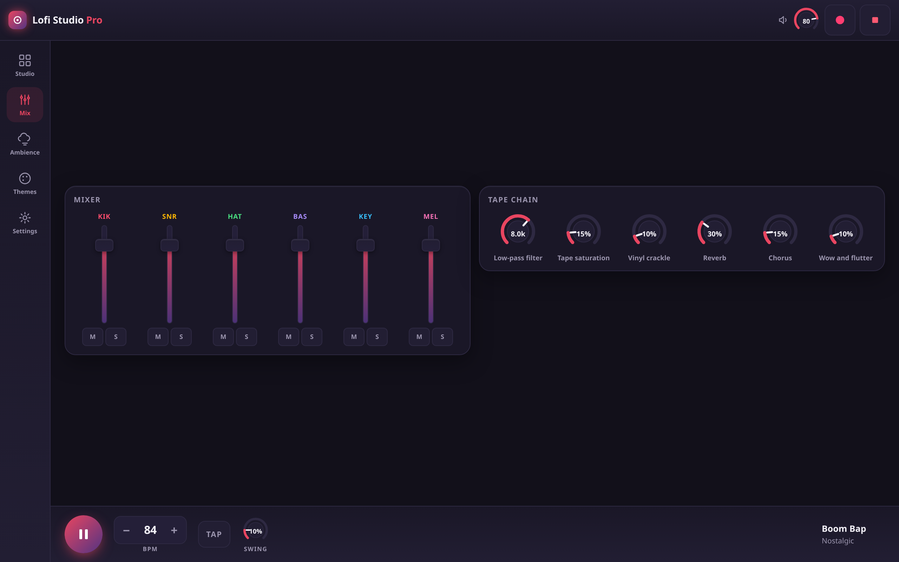
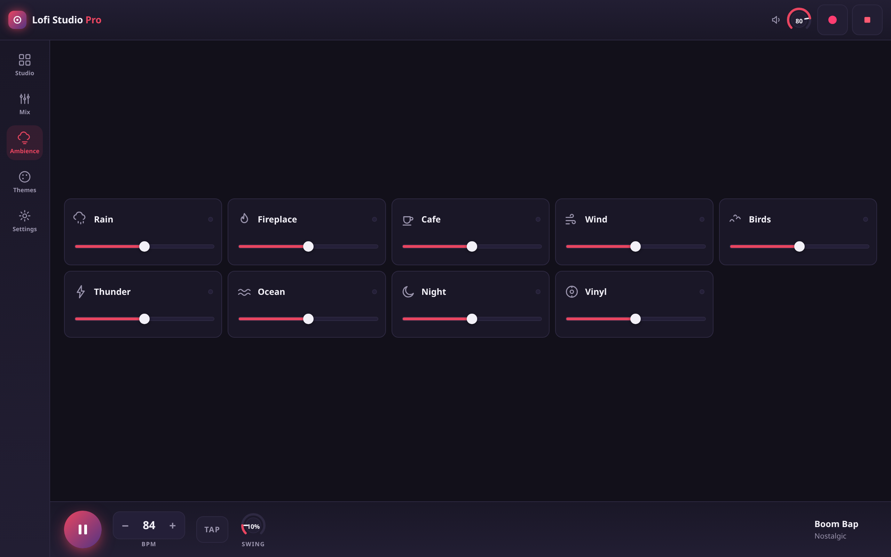
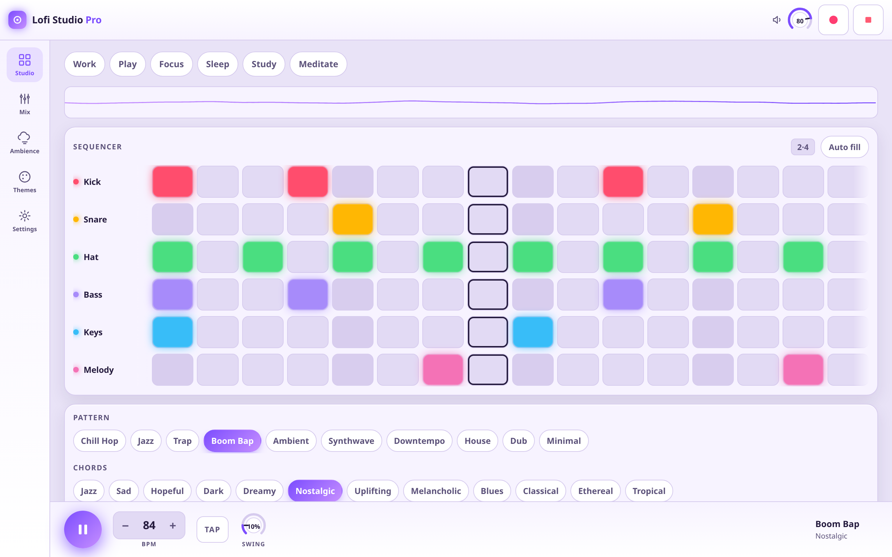
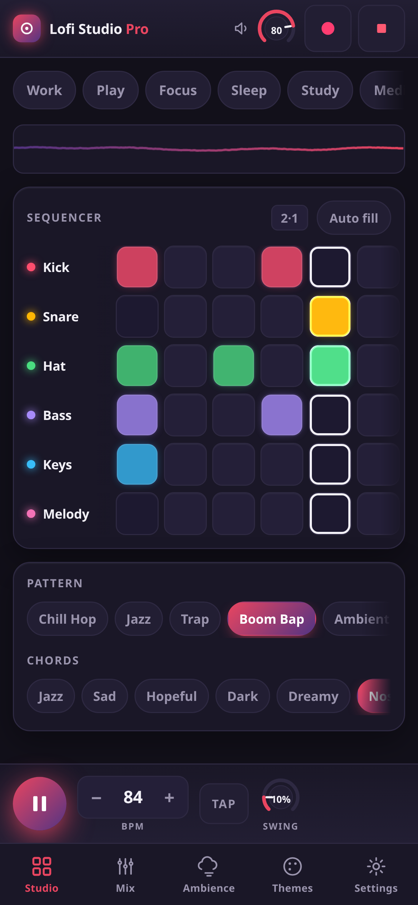

<div align="center">

# Lofi Studio Pro

**A lofi beat machine that runs entirely in your browser.** Six tracks, sixteen steps, nine ambience layers and a live tape chain — all synthesised on the fly, no samples, no account, no server.

[**▶ Open the app**](https://drsamonline.github.io/lofi-studio-pro/) · [Landing page](https://drsamonline.github.io/lofi-studio-pro/landing.html) · [Report a bug](https://github.com/drsamonline/lofi-studio-pro/issues)

[](LICENSE)
[](https://github.com/drsamonline/lofi-studio-pro/releases)
[](manifest.webmanifest)
[](https://github.com/drsamonline/lofi-studio-pro/actions/workflows/tests.yml)
[](docs/TEST-REPORT.md)
[](.)
[](.)



</div>

---

## What it is

Open the page, press play, and you have a beat. Tap pads to change the pattern, drag the tempo, roll the tape chain until it sounds like a dusty cassette. Every kick, hat and chord is generated by an oscillator in your browser — nothing is downloaded or streamed, and after the first visit the whole thing works with the network switched off.

It was built for the ninety seconds between two tasks: no login, no library, no "start a project". One screen, one sound, immediate.

## Features

**Sequencer** — six tracks (kick, snare, hat, bass, keys, melody) across sixteen steps, with ten ready patterns, twelve four-bar chord progressions, swing from straight to lazy, and an optional snare fill every fourth bar. Tap a pad to switch it on, **hold it** to cycle normal → accent → ghost, **drag** across a row to draw a run. Hold a track name to empty that row. Tap a track name to mute it; the mixer has per-track faders and solo.

**Tape chain** — low-pass filter, tape saturation, vinyl crackle, reverb, chorus and wow-and-flutter, all live while the beat runs.

**Ambience** — nine procedurally generated layers (rain, fireplace, cafe, wind, birds, thunder, ocean, night, vinyl), each with its own volume, mixable on their own without a beat.

**Ten themes** — from a near-black studio to a paper-white daytime mode, all driven by CSS custom properties so the swap is instant.

**Recording** — hit the record button to capture a take as a downloadable audio file.

**Installable and offline** — a service worker precaches the shell, Tone.js included, so the app opens from the home screen with no connection at all.

**Honest about your data** — no analytics, no cookies, no network calls after load. Your pattern lives in `localStorage` on your device.

## Quick start

**Use it** — open <https://drsamonline.github.io/lofi-studio-pro/> and press play.

**Install it** — in Chrome or Edge, use the install button in the top bar (or *Install app* from the address bar). On iPhone, Share → *Add to Home Screen*.

**Run it locally** — it is a static site with no build step:

```bash
git clone https://github.com/drsamonline/lofi-studio-pro.git
cd lofi-studio-pro
python3 -m http.server 8000
# open http://localhost:8000
```

Opening `index.html` straight from disk also works; only the service worker is skipped, because offline caching needs `http://` or `https://`.

## Controls

| Action | Keyboard | Touch / mouse |
| --- | --- | --- |
| Play / stop | `Space` | Play button |
| Move around the sequencer | Arrow keys | Tap a pad |
| Accent / ghost a step | — | Hold a pad |
| Draw a run of steps | — | Drag across a row |
| Empty a track | — | Hold the track name |
| Mute a track | — | Tap the track name (sequencer) or `M` (mixer) |
| Solo a track | — | `S` in the mixer |
| Tempo | — | `−` / `+`, or `TAP` four times |
| Surprise me | `S` | Settings → Roll |
| Next theme | `B` | Themes tab |
| Record a take | `R` | Record button in the top bar |
| Stop everything | `X` | Panic button |
| Share the beat | — | Settings → Copy link |

Knobs and faders accept a drag, a scroll wheel, and arrow keys. Double-click a knob to reset it. Hold `Shift` while dragging for fine adjustment.

## What it sounds like, and why

The 2.0 engine sounded like noise because it mostly *was* noise: a bare white-noise snare, a white-noise hi-hat through a high-pass, a kick three times louder than everything else, and a reverb wired as an insert — which meant the dry signal never reached the output at all. On top of that, the bass and melody were monophonic and cut their own release on every consecutive sixteenth.

2.1 rebuilds the voice design and the gain staging. Measured on the same four seconds of the same pattern:

| | 2.0.0 | 2.1.0 |
| --- | --- | --- |
| Peak | 0.68 | 0.54 (no clipping) |
| Crest factor | 7.9 | 6.9 |
| Snare | white noise burst | tuned body + band-limited crack |
| Hi-hat | broadband hiss | band-passed tick with a bell |
| Reverb | insert — dry signal lost | parallel send |
| Bass / melody | monophonic, self-cutting | polyphonic |
| Master | limiter only | 2:1 glue compressor → limiter → DC block → fades |



The figure is generated from real captures of the running app, not from a mock: the top two traces are the same pattern's output, and the bottom is the spectrum of the same window. The 2.0 trace never returns to silence between hits; the 2.1 trace does.

## Screenshots

| Studio | Mixer and tape chain |
| --- | --- |
|  |  |
| **Ambience** | **Light theme** |
|  |  |

<div align="center">

</div>

## Under the hood

A static site, split into five plain scripts. No framework, no bundler, no dependencies to install — the only third-party code is Tone.js, vendored in `vendor/`.

```
index.html                 the app shell: top bar, rail, views, transport
css/app.css                design tokens per theme, layout, controls
js/data.js                 patterns, chord sets, themes, presets, ambience definitions
js/state.js                defaults, validation, persistence, migration from v1
js/audio.js                the whole synthesis engine: instruments, FX, transport, ambience
js/ui.js                   rendering, knobs, faders, toasts, visualiser
js/main.js                 controller: transport, presets, recording, PWA wiring
sw.js                      precache + navigation fallback
manifest.webmanifest       install metadata, icons, shortcuts
vendor/tone.min.js         Tone.js 14.8.49 (MIT)
```

Signal path: six instrument channels → low-pass → tape → chorus → wow → reverb → master volume → limiter → destination, with the vinyl crackle deliberately tapped in after the low-pass so the pops stay crisp, and a recorder hanging off the limiter.

Three decisions worth knowing:

- **Everything is validated at the edge.** `state.js` coerces and clamps every value on load, so a corrupted or half-written save can never reach the audio engine. A save from the old single-file build is migrated automatically.
- **Nothing is locked behind a timer.** The transport is guarded by a promise, not a millisecond timeout — the previous version used a 180 ms lock and a 150 ms restart, which silently swallowed every restart.
- **The shell ships with its own dependencies.** Tone.js is served from `vendor/`, not a CDN, so a blocked network cannot leave a drawn but silent app.

## Testing

91 browser checks run against the real app in headless Chromium — every transport control, all ten patterns, twelve chord sets, ten themes, nine ambience layers, the six knobs, the faders, per-step velocity, drag-to-paint, hold-to-clear, link sharing, the sleep timer, the media session, audio headroom, persistence, a corrupted save, migration from v1, recording, offline reload, and the layout at 360 / 390 / 768 / 1280 px.

```bash
pip install websocket-client && python3 tests/run_browser_tests.py
```

Results: **[docs/TEST-REPORT.md](docs/TEST-REPORT.md)** — 88 passing, 0 failing.

## Native builds

The web app is the source of truth; the wrappers are thin and live in CI, so nothing has to be installed locally and no stale binary is ever committed.

| Target | How | Built |
| --- | --- | --- |
| **Android** | `.github/workflows/android.yml` wraps the static files with Capacitor | `lofi-studio-pro-2.1.0.apk` (3.8 MB) — debug-signed, so sideload it |
| **Windows** | `.github/workflows/windows.yml` wraps the same files with Tauri (WebView2) | `Lofi-Studio-Pro-2.1.0-x64-setup.exe` (2.1 MB) and `.msi` (3.0 MB) |
| **PWA** | The live site installs to any home screen | tested — this is the build the 88 browser checks run against |

All three are attached to the [v2.1.0 release](https://github.com/drsamonline/lofi-studio-pro/releases/tag/v2.1.0). Push a tag and CI rebuilds them from that exact commit.

The Android build is debug-signed, so it installs from a file but cannot go to the Play Store as-is: add your own keystore as repository secrets and a `signingConfig` to `android/app/build.gradle`. The Windows binaries are unsigned, so SmartScreen will warn on first run.

## Roadmap

The next round of ideas — features, offline behaviour, performance, and a short list of things deliberately left out — is in **[ROADMAP.md](ROADMAP.md)**. The first eight are already shipped in 2.1.0 and marked as such. Every feature in this version is catalogued in **[docs/FUNCTIONS.md](docs/FUNCTIONS.md)**.

## Licence

[**PolyForm Noncommercial License 1.0.0**](LICENSE) — free to use, change and share for any noncommercial purpose: personal projects, study, hobby work, teaching, research, charities and public institutions. Commercial use needs a separate licence; [open an issue](https://github.com/drsamonline/lofi-studio-pro/issues) and ask.

> Required Notice: Copyright Dr Sohil Momin (https://github.com/drsamonline)

If you would rather have a permissive or copyleft licence, the code is yours to relicense only with my permission — but do ask, I usually say yes for MIT.

## Attribution

- **[Tone.js](https://tonejs.github.io/)** 14.8.49 — MIT, © Yotam Mann and contributors. The entire sound engine sits on top of it.
- **Every sound is synthesised.** No samples, loops, records or third-party audio assets are included, so there is nothing to clear and nothing to credit beyond the library.
- **Icons** are drawn in this repository (SVG paths in `js/data.js` and `index.html`), and the PNG app icons are generated from the same shapes.
- **Type** is the system UI font stack — no webfont is loaded.
- Full detail in **[ATTRIBUTION.md](ATTRIBUTION.md)**.

## Sponsor

Lofi Studio Pro is free and stays free for personal use. If it earned a place in your workday:

- **[Sponsor on GitHub](https://github.com/sponsors/drsamonline)** — one-off or monthly.
- **Star the repo** — it genuinely helps other people find it.
- **Send a pattern** — open an issue with a screenshot of something good; good presets get shipped in the next release.

## Author

**Dr Sohil Momin** — built and maintained by one person, in between other things.

[GitHub](https://github.com/drsamonline) · [sohilmomin2000@gmail.com](mailto:sohilmomin2000@gmail.com)

<div align="center"><sub>If this saved you from a "lofi beats to study to" playlist, that was the point.</sub></div>
